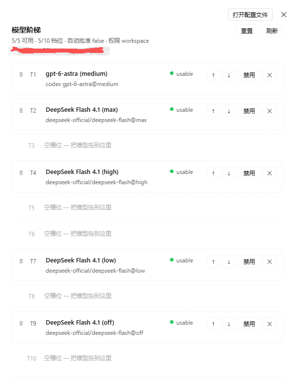
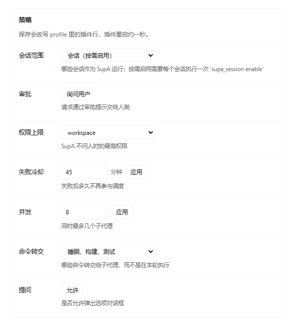
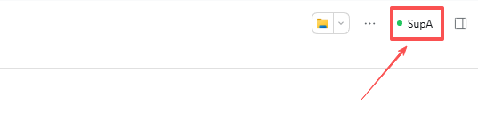
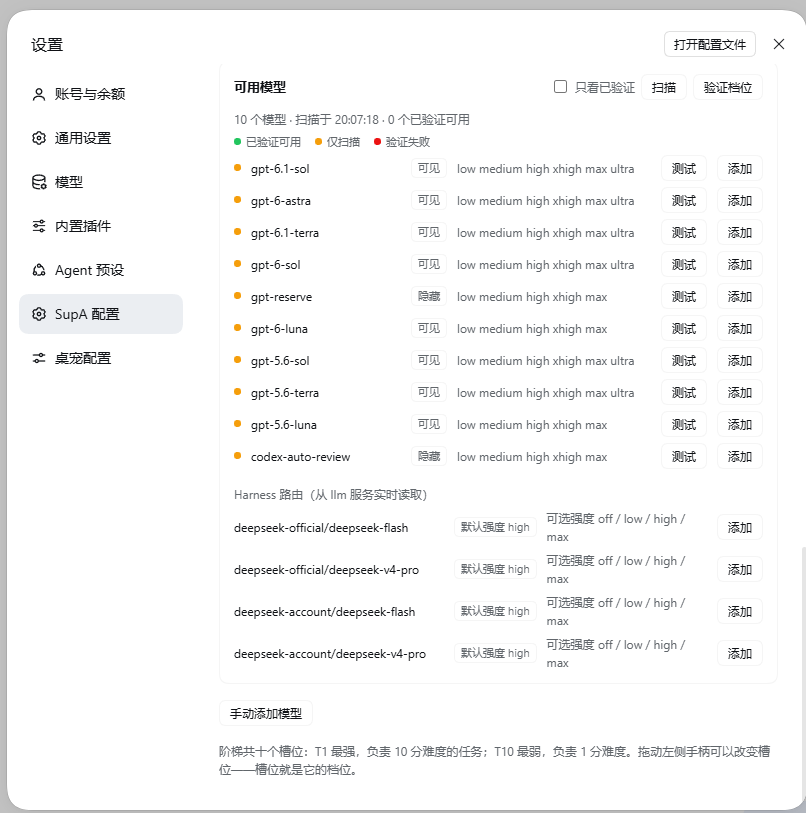

# dsh-ladder-superagents

[English](README.md) · **中文**

> **0.1 仅支持 Windows。** CLI 发现、`.cmd` 启动和路径处理都是按 Windows
> 编写的。在 macOS 和 Linux 上，llm 层级可用，CLI 层级不可用。
> `package.json` 里的 `os: ["win32"]` 已经写明了这一点。
>
> 十个 CLI 驱动中只有 **codex** 经过验证。kimi、claude、gemini、
> qwen、cursor、opencode、aider、copilot 和 goose 都是按各自 CLI 的
> 官方文档调用方式实现的，但从未针对一个可用的账号实际运行过 ——
> 尤其是 claude 需要付费的 Claude 订阅，而 kimi 需要 Kimi 账号。
> 这九个都应当视为实验性。
>
> 审批行为是**继承来的**：插件本身不回答任何审批请求。
> `autoApprove: true` 是显式选择加入，而不是默认值。

一个 DeepSeek Harness bundle，遵循
[`deepseek-ai/dsh-superagent-prototype`](https://github.com/deepseek-ai/dsh-superagent-prototype)
的概念，把 profile 中选定的会话变成 **SupA** 会话。

包 id：`dsh-ladder-superagents`。





原型的思想，被归约为每个会话的三个属性：

| 属性 | 原型机制 | 本插件 |
| --- | --- | --- |
| **永不阻塞** | 路由器做决定；Executor 上报而不是等待 | 审批在进程内决定；坏掉的东西先诊断并修复，然后才去问人；提问只保留给修复无法获得的东西（一个凭据、一笔付款、对一个不可逆决定的裁决） |
| **拥有全部上下文** | 工单记录、限定范围的 `orchestrator_read` | 一个工作区台账（`.dsh-supa/context.jsonl`），每个会话都可读写，并以实时摘要的形式注入系统提示词 |
| **决定子会话的上下文** | 把 Mandate 和限定范围的 Inputs 交给 Executor | `supa_spawn` 依据父会话的选择构建上下文包；子会话用 `supa_context_request` 拉取更多内容，父会话用 `supa_context_supply` 回答 |

## 它注册了什么

工具（每个会话都有）：

| 工具 | 用途 |
| --- | --- |
| `supa_context` | 对共享台账执行 `write` / `read` / `search` / `list` / `digest` |
| `supa_spawn` | 用一个任务简令加上显式的上下文选择（台账 id/tag、文件、最近 N 条消息、额外文本）启动一个子会话 |
| `supa_context_request` | 子会话 → 父会话：索取它没有被给予的上下文 |
| `supa_context_supply` | 父会话 → 子会话：交付那份上下文（若子会话空闲则唤醒它） |
| `supa_status` | 模式、台账路径/大小、未完成的 todo、存活的子会话 |
| `supa_report` | 子会话 → 父会话：把一条 progress/result 记录入队到父会话的收件队列，而不唤醒它 |
| `supa_inbox` | 父会话：对收件队列执行 `peek` / `drain` / `stats`，按子会话 lane 分组；`drain` 接受可选的 `ids`，于是 SupA 能保留有用的记录待处理，只抽取其余的 |
| `supa_authority` | 父会话：设置某个直接子会话的权限（`workspace` / `full`）；被夹取到父会话自身的级别 |
| `supa_models` | 管理层级：`list`、`scan`（读取 `codex debug models`，可选地用一次真实调用逐个 pin 每个模型）、`add`、`remove`、`move`、`route` |

系统提示词：一个 `SupA session charter` 段，再加上一份 `supa:state` 上下文，
其中包含最近的台账摘要和未完成的 todo。

运行时行为：

- 对 SupA 会话，`approval/request` 被回答为 `allowed-once`，并且每一次
  授予都会以 `auto-approval` 追加到台账。
- `ask_user_question` 默认允许：当某个决定确实是用户的决定时，SupA 会弹出
  选项而不是靠猜。设置 `denyBlockingQuestions: true` 可以让该工具改为
  以“自行决定并记录”的指令失败。
- 以 `blocked` 结束的一轮会被一条“不要等待”的提示唤醒（每个会话每
  10 分钟最多 3 次；计数器会衰减，所以它不可能无限循环）。
- 可选：以 `completed` 结束但仍有未完成 todo 的一轮会再次被唤醒
  （`continueOnOpenTodos`，默认关闭）。

## 配置

在 bundle 的 `cordis.patch.yml` 中 `supa` 那一行上设置：

| 键 | 默认值 | 含义 |
| --- | --- | --- |
| `enabled` | `true` | 总开关 |
| `mode` | `session` | `session` = 每个会话通过 `supa_session enable` 选择加入；`all` = 每个会话；`root` = 只有没有父会话的会话；`preset` = 只有列出的 `presets` |
| `presets` | `[]` | 用于 `mode: preset` 的 preset id |
| `ledgerDir` | `.dsh-supa` | 台账目录，相对于会话工作目录 |
| `autoApprove` | `false` | 继承 harness 策略。`true` 让 SupA 自己回答每一个审批请求 |
| `denyBlockingQuestions` | `false` | 拒绝 `ask_user_question`，而不是让它提问 |
| `continueWhenBlocked` | `true` | 唤醒 `blocked` 的一轮 |
| `maxBlockedNudges` | `3` | 每个 `nudgeWindowMs` 内的提示次数 |
| `nudgeWindowMs` | `600000` | 提示计数器的衰减窗口 |
| `continueOnOpenTodos` | `false` | 在 todo 仍未完成时也继续 |
| `maxTodoNudges` | `6` | todo 触发器在每个窗口内的提示次数 |
| `spawnProvider` | `spawn` | `supa_spawn` 使用的 `ctx.subagents` provider |
| `childPreset` | `''` | 子会话使用的 agent preset；空值继承父会话 |
| `retryOnFailure` | `true` | 被路由的子会话因 error/max-tokens/refusal 停止时，降一个层级重新 spawn |
| `maxRouteRetries` | `2` | 降级这么多次之后停止 |
| `tierAttempts` | `2` | 在同一层级上的尝试次数，之后它被标记并释放其槽位 |
| `tierRetryDelayMs` | `1200` | 重试同一层级前的暂停 |
| `codexCommand` | `''` | codex CLI 的绝对路径；空值会依次发现 `~/.codex/plugins/*/codex.exe` 和 `~/.cargo/bin/codex.exe` |
| `cliTimeoutMs` | `900000` | 在这段时间之后杀掉一次 codex 运行 |
| `maxCliResultChars` | `8000` | 回队给父会话的结果的长度上限 |
| `maxPackBytes` | `24000` | 上下文包上限 |
| `maxFileBytes` | `8000` | 单个文件上限 |
| `maxFiles` | `6` | 每个上下文的文件数 |
| `maxTranscriptMessages` | `30` | `transcript_messages` 的上界 |
| `maxTranscriptChars` | `700` | 对话记录中每条消息的上限 |
| `promptDigestNotes` | `8` | 提示词摘要中的台账行数 |

## 安装

dsh-ladder-superagents 是一个 DeepSeek Harness **bundle**：一个在 `package.json`
中声明了 `dsh.bundle.patch` 的包。把它安装进一个 profile 会插入它的插件行
（Host 半边）和它的 Client 半边。

```bash
git clone https://github.com/Yukikaze-Ai/dsh-ladder-superagents.git
```

然后，在你希望它生效的那个 Harness 中，用 Plugin Manager 的
“install from a directory”动作把克隆下来的目录作为 bundle 安装，并指向那个
检出目录。Host 半边和 Client 半边会一起激活：工具出现在每个会话中，
charter 加入下一次提示词组装，Settings 中新增一个「SupA 配置」页面。
没有重新构建的步骤 —— Client 模块是通过 Harness 模块加载器加载的纯
JavaScript。

安装之后，工具会出现在每个会话中，并且 charter 会参与下一次提示词组装。

## 在会话里启用

默认是 `mode: session`，所以**不会自动启用**。一个会话在你明确表示之后才成为
SupA，而且这个选择按会话记住：



- **胶囊。** 会话头部有一个安静的 `SupA` 控件：绿点表示这个会话是 SupA，
  灰色表示未启用。点一下即可切换。
- **工具。** 在对话里，`supa_session enable` 做同一件事，`supa_session status`
  报告当前状态。
- **关闭是软停止。** 新的派活会被拒绝，但已经在跑的子代理会继续工作；它们的
  报告留在队列里，下次启用时再浮出来。

## 拓扑：星形结构，每条边上一个队列

```
            ┌──────────── SupA (parent) ────────────┐
   spawn ──▶│  inbound queue: one file, N lanes     │
            │  drained deliberately, not per-event  │
            └───▲──────────▲──────────▲─────────────┘
                │lane A    │lane B    │lane C
            child A     child B     child C      (no A↔B, A↔C, B↔C edge)
```

- **没有横向的边。** 一个子会话只能到达它的直接父会话（harness 在
  `send_message` 上强制邻接关系），并且上下文包里的 charter 写明了这一点。
- **每个 SupA 一个收件队列。** `supa_report` 把一条记录追加到
  `<ledger>/inbox/<parent>.jsonl`，并向父会话的收件箱注入一行，*不唤醒它*。
  父会话的 `supa_inbox` 负责抽取队列；顺序按 lane 保留。
- **每批一次唤醒。** 只有空闲的父会话会被唤醒，每个 `coalesceMs` 窗口一次，
  带一个指针（“N 份报告，分布在 M 个 lane”），绝不是每个子会话事件一次唤醒。
  忙碌的父会话只是在其下一步里找到这些报告。
- **两种体制。** 有存活子会话上限时，父会话就是调度器：上限属于
  `supa_spawn`，待处理的分配在父会话的队列中等待。没有上限时，每个子会话
  都是一个独立的 lane，有自己的队列和自己的上下文，lane 之间除了台账之外
  不共享任何东西。

已经是原生能力、无需插件代码的部分：`agent.inbox`（每会话持久的
下一轮/下一步队列）、`send_message` 上的邻接关系，以及 `ctx.subagents`
的激活管理。本插件新增的部分：持久的按 lane 队列、合并唤醒，以及模型
可以推理的 drain 语义。

## 权限向下流动，绝不向上

每个会话持有一个级别：`workspace`（默认）或 `full`。

- 在级别之内的请求会被授予一次，并在台账中审计。
- 子会话超出其级别的请求会被拒绝，并作为一条 `permission` 记录停在父会话的
  队列中。父会话用 `supa_authority` 作答，并让子会话重试；它授予的权限
  永远不能超过它自己持有的。
- 根会话超出其级别的请求会通过常规审批提示交给人类。这是仅剩的人类关卡，
  而且它只为提权而存在 —— 从不为日常工作而存在。

## 难度路由

SupA 给任务打 1-10 分；`supa_spawn` 带上 `difficulty: 7` 就会选出对应层级。

- 层级存放在 `.dsh-supa/models.json` 中：一个有序数组，最强的在前，每个条目为
  `{ id, label, provider, model, reasoningEffort, ceiling, enabled }`。
- `ceiling` 是该层级预期能处理的最难分数。路由器取**上限仍能覆盖该分数的最弱
  层级** —— 一个 2 分的任务绝不会烧掉最强的模型 —— 只有当没有任何层级覆盖时
  才回退到可用的最强层级。
- 思考级别是独立的行，而不是第二个维度。一个模型的各个级别是连续的层级：
  `Flash MAX = 7`、`Flash high = 5`、`Flash low = 3`、
  `Flash none = 1`。排序始终是一个全序，所以“哪个更强”和“哪个是第三个”
  永远只有一个答案。
- 可用性来自活的 `llm` 服务（`resolveCallConfig`，缓存 60 秒），因此不可用的
  层级会被跳过，改用下一个更低的层级 —— 这就是“一次降一步”的规则。
- 一次失败的尝试会在同一层级上重试一次（`tierAttempts`），之后才被视为模型
  问题：于是该路由被标记在 `.dsh-supa/failures.json` 中，而该层级留在层级表里
  **保持禁用并显示为红色**。删除它的是用户，而该行上的 **Retry** 会探测它
  一次：绿色即重新启用，红色则继续保持排除。当层级表里每一条路由都被标记时，
  最弱的槽位会被内置的 `deepseek-official/deepseek-flash@high` 替换，好让
  池子仍能路由。如果用户反而是手动关掉了某些层级，那就什么都不替换 ——
  那是一个刻意的选择，不是一条坏掉的路由。
- 空层级表意味着子会话原样继承父会话的路由。
- 一个层级可以是外部 CLI 而不是 Harness 路由：`kind: "codex"` 会把
  `codex exec` 作为一个子进程运行，把同一个上下文包从 stdin 喂进去，把权限
  上限映射到 `-s workspace-write | danger-full-access`，并把 CLI 的最后一条
  消息作为一条 `result` 记录回队到 `cli` lane。它不是 Harness 会话 ——
  没有 session id，没有 `supa_context_request`。
- `supa_models scan` 读取 Codex 目录的每一条目（`codex debug models`，
  不创建会话），并缓存到 `.dsh-supa/codex-models.json`，隐藏模型也包含在内 ——
  一个隐藏模型仍然可以被 pin，一个层级也可以指名它。
- `supa_models pin` 测试的是**配置**，不是模型：每个 (model, effort) 组合
  一次真实调用，缓存键为 `model@effort`。传入一个模型就测试它支持的每个
  effort，省略它则测试层级表中的 codex 层级。已缓存的成功结果会被复用，
  除非设置了 `force`。每一次 pin 都会消耗那个模型的 token/用量，
  这就是 scan 和 pin 是两个独立动作的原因。
- `supa_models route difficulty 7` 是一次干跑；它不花任何代价。

需求中的侧边栏正是这个文件的编辑器：重排行、切换可用性、编辑上限、添加
层级。在它出现之前，`supa_models` 就是同一套界面，带同样的校验。

## CLI 驱动程序

一个 `cli` 层级会指名一个 `driver`；驱动拥有参数，插件拥有管道
（spawn、stdin、超时、结果队列、降级）。

| driver | 可执行文件 | 非交互形式 | 提示词 |
| --- | --- | --- | --- |
| `codex` | `codex`（自动发现） | `codex exec` | stdin |
| `kimi` | `kimi` | `kimi -p "<prompt>"` | 参数 |
| `claude` | `claude` | `claude -p` | stdin |
| `gemini` | `gemini` | `gemini -p "<prompt>"` | 参数 |
| `qwen` | `qwen` | `qwen -p "<prompt>"` | 参数 |
| `cursor` | `cursor-agent` | `cursor-agent -p "<prompt>"` | 参数 |
| `opencode` | `opencode` | `opencode run "<prompt>"` | 参数 |
| `aider` | `aider` | `aider --message "<prompt>" --yes` | 参数 |
| `copilot` | `copilot` | `copilot -p "<prompt>"` | 参数 |
| `goose` | `goose` | `goose run -t "<prompt>"` | 参数 |

在这台机器上实际跑过：`codex`、`kimi`。其余的是文档中的调用方式，并未在
这里运行过 —— 错误的参数会大声失败，并且可以用该层级的 `command` 字段修好。

### Windows 与 macOS

- 在 Windows 上通过 npm 安装的 CLI 是一个 `.cmd` shim，`spawn` 无法直接
  执行它。启动器会检测 `.cmd`/`.bat`，并带参数引号地通过 shell 运行。
- 可执行文件的查找在 Windows 上会沿 `PATH` 尝试 `.exe`/`.cmd`/`.bat`，
  在其他平台上则用裸名字；层级里显式的 `command` 永远优先。
- 在 Windows 上优先用 stdin 驱动：命令行长度被限制在约 32k 字符，
  所以把 24 KB 的上下文包作为参数传过去是有风险的。参数驱动对简短的任务
  简令没有问题。
- 配置主目录不同（`%USERPROFILE%\.codex` 与 `~/.codex`，`%APPDATA%` 与
  `~/.config`），这就是为什么 codex 二进制是从它的安装根目录发现的，
  而不是假定它在 `PATH` 上。

## 设置页面



该 bundle 提供一个 Client 半边，在 Settings 面板中注册一个
`dsh-ladder-superagents` 页面（`settings.section`，顺序 25）。它展示所选工作区
的层级表 —— 位置、标签、路由、上限、每个层级的可用性 —— 并就地编辑它：
用 ↑/↓ 重排、启用/禁用、移除，以及添加一个层级（`llm` 路由或 `cli` 驱动）。
当 profile 拥有多于一个工作区时，会出现一个工作区选择器。

该页面不依赖 host RPC；它使用 Host 半边注册的两条同源路由：

| 路由 | 用途 |
| --- | --- |
| `GET /supa/state?cwd=` | 工作区、层级表、可用性、驱动、配置摘要 |
| `POST /supa/action` | `move`、`enable`、`remove`、`add` —— 返回新的状态 |

两者都作用于 `<cwd>/.dsh-supa/models.json`，也就是 `supa_models` 编辑的同一个
文件，因此工具和页面永远不会出现分歧。

层级表下面是 Codex 目录区块。**Scan** 读取目录中的每一条目（包含隐藏的），
不花任何代价。**Pin tiers** 测试层级表中的 codex 层级；每个模型行有自己的
**Pin**，用来测试该模型支持的每个 effort。两条 pin 路径都会针对每个
model+effort 配置发送一次真实调用，并把裁决缓存为 `model@effort`，
所以按钮旁边的警告是字面意义上的：它们会消耗每个模型的 token/用量。

## 许可证

MIT —— 见 [LICENSE](LICENSE)。

## 你应该知道的风险

- 审批行为默认是继承来的。设置 `autoApprove: true` 会授予每一个审批请求，
  包括沙箱提权。这就是“永不阻塞”的代价。把它关掉，SupA 就干脆无法提权；
  它会得到一个确定性的拒绝。
- 一个 `codex` 层级是一个普通子进程，不是 Harness 会话：审批系统和权限
  记账都不管辖它。权限上限被映射到 codex 自己的 `-s` 标志上，
  那就是全部的控制手段。
- 台账存放在工作区里（`.dsh-supa/`），所以它随仓库一起走。如果你不想让它
  被提交，就把它加进 `.gitignore`。
- 在 `mode: 'all'` 下 charter 适用于每个会话。请使用 `mode: 'session'`
  （默认值），让会话通过 `supa_session enable` 选择加入。

## 参与贡献

Bug 和复现是最有用的贡献。阅读
[CONTRIBUTING.md](CONTRIBUTING.md) 了解本地循环以及这个代码库踩坑学到的
规则，然后从 [ROADMAP.md](ROADMAP.md) 里挑一件事 —— 仅 Windows 的移植和
路由测试都标记为 `good first issue`。

发布说明位于 [CHANGELOG.md](CHANGELOG.md)。


